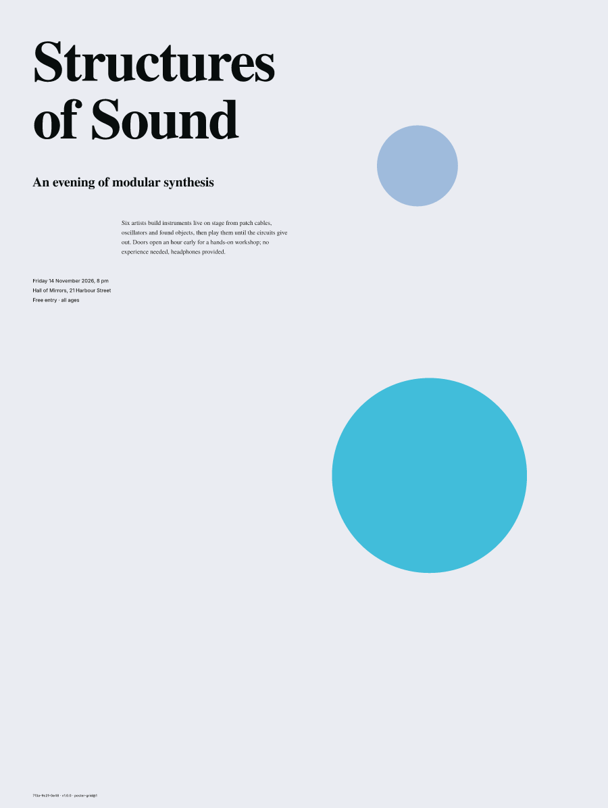
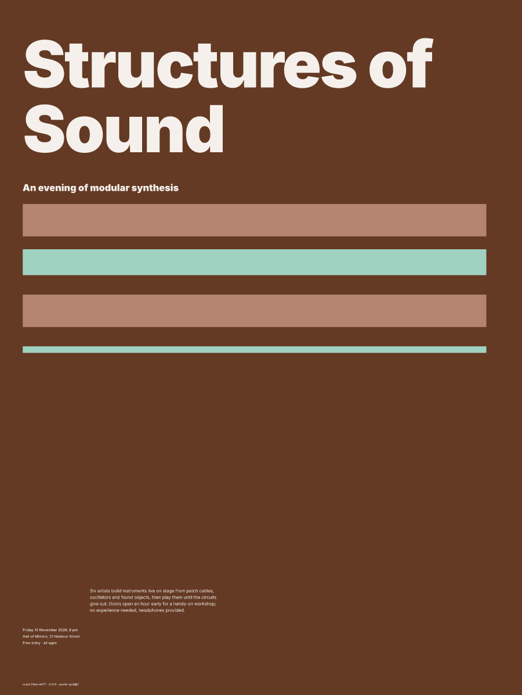
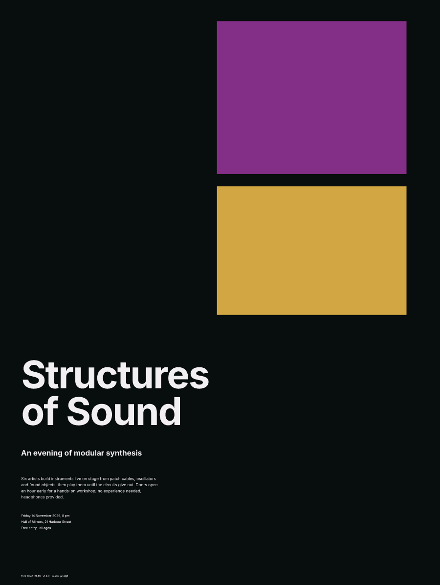
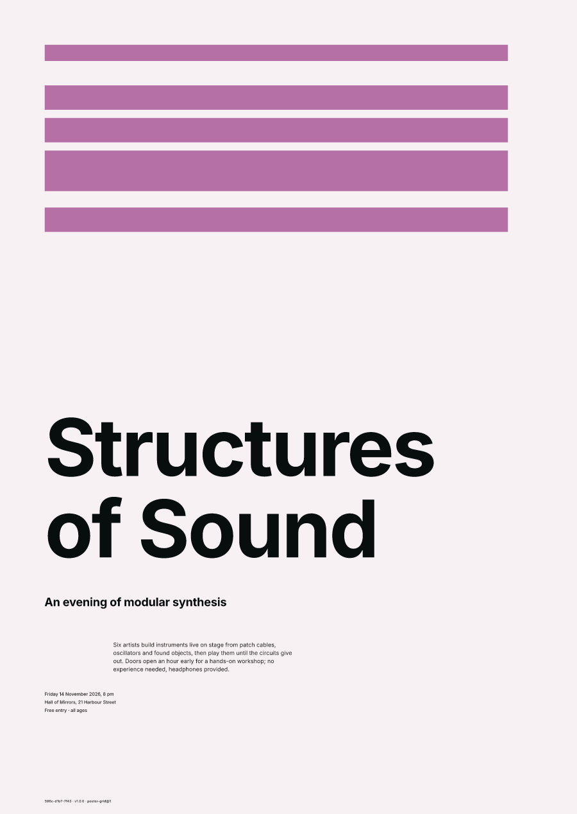

# Generative Poster System

Seeded, reproducible poster layouts from a grammar of grids, palettes and type
scales, exported as **PDF/X-4 files ready for offset press** and as SVG.

<p>




</p>

Every poster prints its own provenance (`7f3a-9c21-0e48 · v1.0.0 · poster-grid@1`).
That caption is enough to regenerate the poster byte for byte, in Node or any browser.

## What's in v1

- **Deterministic core.** PCG32 with named sub-streams, deterministic maths in place of platform transcendentals, and integer geometry. A lint rule enforces this.
- **Document model.** It is the only place decisions are made. The SVG and PDF renderers translate it and decide nothing.
- **Type engine.** HarfBuzz shaping, baseline-grid leading, a modular scale, optical tracking and overhang, measure control, and OS/2 licence checks.
- **Colour engine.** OKLCH palettes converted through FOGRA39 with LittleCMS, with ΔE gamut safety, a TAC limit, and rich black vs 100K chosen by role and size.
- **Grammar.** Versioned JSON with hard constraints and deterministic resampling. 10,000 of 10,000 seeds satisfy every constraint.
- **PDF/X-4 writer.** Output intent, DeviceCMYK transparency group, XMP, nested boxes, outlined text with `/ActualText`, and ExtGState opacity. It passes qpdf and an independent PDF/X-4 structural checker.
- **Scoring.** Eight layout heuristics, generate-and-filter batches, and Bradley–Terry weight tuning from A/B choices.
- **Poster Studio.** Browser UI with live preview, guides, ink-coverage map, batch grid, A/B preferences, replay, and PDF/SVG export.
- **Stretch goals.** Series, large-format tiling, QR seed cards, a CSS Paged Media renderer, and Risograph separations. See [what was built](1—Documentation/v1/stretch-goals.md).

## Quick start

```bash
cd v1
npm install
npm run demo                     # generate one poster, print its hash
npm run export -- out 7f3a-9c21-0e48   # SVG + PDF/X-4, with preflight
npm run batch -- 0000-0000-0001 64 8   # best 8 of 64 into out/batch
npm run studio                   # Poster Studio at http://localhost:5173
```

## Checks

```bash
npm run lint          # determinism lint
npm run typecheck
npm test              # unit, determinism fixtures, 2k-seed properties, PDF, conformance corpus, visual goldens
npm run verify        # 10,000-seed hard-constraint and preflight sweep
npm run test:browser  # fixture hashes inside Chromium / Firefox / WebKit
```

The conformance corpus needs `qpdf` and Python `pikepdf`. Without them, those
assertions are skipped. Certified PDF/X validation (callas, Acrobat
Preflight) is still a manual step before a real print run; see the
[print spec](1—Documentation/v1/print-spec.md).

## Documentation

All documentation lives in [`1—Documentation/`](1—Documentation/README.md):
the [design & build guide](1—Documentation/design-guide.md), the
[print specification](1—Documentation/v1/print-spec.md),
[determinism](1—Documentation/v1/determinism.md), the
[grammar reference](1—Documentation/v1/grammar-reference.md) and the
[Studio guide](1—Documentation/v1/studio.md).

<!-- project-metrics:start -->
## Project Metrics

[](https://github.com/syedjafri06193/Generative-Poster-System-proj/stargazers) [](https://github.com/syedjafri06193/Generative-Poster-System-proj/forks) [](https://github.com/syedjafri06193/Generative-Poster-System-proj/issues) [](https://github.com/syedjafri06193/Generative-Poster-System-proj/commits/improvements) [](https://github.com/syedjafri06193/Generative-Poster-System-proj/commits/improvements) [](https://github.com/syedjafri06193/Generative-Poster-System-proj) [](https://github.com/syedjafri06193/Generative-Poster-System-proj)

### Code

| Metric | Value |
|---|---|
| Lines of code | 3,116 |
| Source files | 61 |
| Tracked files | 99 |
| Documentation | 9 Markdown files (11,954 words), 1 PDF |
| Commits | 8 |
| Contributors | 1 |
| Active | 2026-09-11 → 2026-10-29 |

| Language | Lines | Share |
|---|---:|---:|
| TypeScript | 2,878 | 92.4% |
| Python | 117 | 3.8% |
| HTML | 69 | 2.2% |
| JavaScript | 52 | 1.7% |

<sub>Code stats as of 2026-10-29, counted with pygount (comments and blank lines excluded). Badges update live.</sub>
<!-- project-metrics:end -->

## Licence

Code: [MIT](LICENSE). Bundled fonts: Inter (SIL OFL 1.1) and TeX Gyre Termes
(GUST Font License); their licences are in `v1/fonts/`. FOGRA39 profile:
`v1/profiles/`, distributed free of known copyright restrictions.
